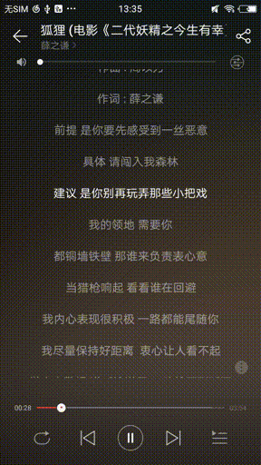
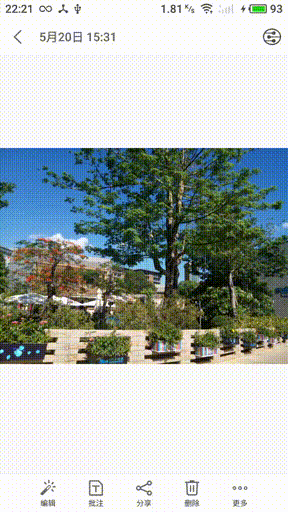

# PlatinumMedia

基于 Platinum SDK（铂金）的 Android DLNA 学习项目，用于在 Android 上实现 DLNA 服务端/客户端能力。

[](https://github.com/huzongyao/PlatinumMedia)
[](https://github.com/huzongyao/PlatinumMedia/releases)
[](https://github.com/huzongyao/PlatinumMedia/releases)

#### 截图
|   Video       |   Audio       | Image |
| ------------- |:-------------:| -----:|
| | |  |

#### 项目简介

该项目基于 C++ 开源库 [Platinum SDK](https://github.com/plutinosoft/Platinum)（铂金）学习 DLNA 服务协议，Platinum 又依赖于 C++ 开源库 [Neptune](https://github.com/plutinosoft/Neptune)（海王星）。源码本身已适配 Android，无需修改即可编译，Log 打印也完美兼容。

DLNA（数字生活网络联盟）涉及三种核心角色：

* **Digital Media Server (DMS)** 数字媒体服务器：提供媒体档案的获取、录制、储存，作为内容来源。
* **Digital Media Renderer (DMR)** 数字媒体渲染器：接收并播放从 DMC 推送过来的多媒体（图片、音乐、视频）。
* **Digital Media Controller (DMC)** 数字媒体控制器：作为遥控装置，寻找 DMS 上的多媒体档案，并指定可播放该档案的 DMR 进行播放或控制。

本项目把这套能力封装为标准的 Android Gradle 多模块工程，原生代码通过 JNI 暴露给 Java 层调用。

#### 工程结构

```
PlatinumMedia/
├── settings.gradle          # 根配置，包含 :platinum :client :server 三个子模块
├── build.gradle             # 根构建脚本（AGP 8.9.1）
├── platinum/                # 原生库模块（com.android.library）
│   └── src/main/
│       ├── cpp/             # C/C++ 源码与 CMake 构建脚本
│       │   ├── CMakeLists.txt   # 编译 libplatinum.so（arm64-v8a）
│       │   ├── PlatinumApi.{h,cpp}  # JNI 桥接入口
│       │   ├── Hupnp/           # Android 侧封装（AndUPnP 等）
│       │   ├── Neptune/         # Neptune 运行时（Core/System/...）
│       │   ├── Platinum/        # Platinum UPnP SDK
│       │   │   ├── Core/        #   控制点、设备主机、SSDP、HTTP、任务
│       │   │   ├── Devices/     #   MediaServer / MediaRenderer / MediaConnect
│       │   │   └── Extras/      #   额外工具
│       │   └── json/            # nlohmann JSON（参数解析）
│       └── java/com/plutinosoft/platinum/
│           └── NativeUpnpApi.java  # 单例 JNI 封装（loadLibrary "platinum"）
├── server/                  # DMR 渲染器 App（com.hzy.platinum.server）
│   └── src/main/java/com/hzy/platinum/server/
│       ├── activity/        # SplashActivity（显示版本）/ MainActivity（播放界面）
│       ├── service/         # DLNAService（前台服务 + 多播锁 + 原生渲染器）
│       ├── player/          # PlayerManager（按渲染器事件驱动 MediaPlayer）+ MediaType（媒体类型判定）
│       └── utils/UUIDUtils  # 持久化设备 UUID
└── client/                  # DMC 控制器 App（com.hzy.platinum.client）
    └── src/main/java/com/hzy/platinum/client/
        └── activity/        # SplashActivity / MainActivity（设备发现 + 投送控制）
```

#### 原生层与 JNI 桥接

原生库 `libplatinum.so` 由 `platinum/src/main/cpp/CMakeLists.txt` 通过 `GLOB_RECURSE` 编译所有 `*.cpp` 生成，链接 `log`、`android`，目标 ABI 为 `arm64-v8a`。`LOAD` 段已按 16 KB 对齐（`-Wl,-z,max-page-size=16384`），兼容 Android 15+ 16 KB 设备。

JNI 入口集中在 `PlatinumApi.{h,cpp}`，通过 `JNI_FUNC` 宏映射到 Java 类 `com.plutinosoft.platinum.NativeUpnpApi`：

| JNI 函数 | 作用 |
| --- | --- |
| `getVersionString` | 返回 `PLT_PLATINUM_SDK_VERSION_STRING` |
| `nInit` | 创建 `AndUPnP` 实例并返回指针（C++ 对象句柄） |
| `nSetCallback` | 注册 Java 回调 `onEvent(String):String` |
| `nAddRenderer` | 解析 JSON 参数并添加 `PLT_MediaRenderer` 设备（含 `AndMediaRenderer` 委托） |
| `nAddController` | 解析 JSON 参数并添加 `PLT_MediaController` 控制点（含 `AndMediaController` 委托，负责设备发现） |
| `nInvokeAction` | 解析 JSON 动作并发送到指定渲染器（DMC 投送指令） |
| `nStart` / `nStop` | 启动 / 停止 `PLT_UPnP` |

`AndUPnP`（位于 `Hupnp/AndUPnP.{h,cpp}`）封装了 `PLT_UPnP`，负责：

* `AddRenderer`：从 JSON（`friendly_name` / `show_ip` / `uuid` / `port` / `port_rebind`）构造 `PLT_MediaRenderer`，并通过 `AndMediaRenderer` 委托把 AVTransport/RenderingControl 指令序列化为 JSON 回调 Java；
* `AddController`：创建 `PLT_CtrlPoint` + `PLT_MediaController`，由 `AndMediaController` 委托把发现的渲染器（`{"type":"device",...}`）与动作结果（`{"type":"action",...}`）上抛 Java；
* `InvokeAction`：按 `uuid` + `action` 查找渲染器并调用对应 AVTransport/RenderingControl 动作；
* `notifyJEvent`：通过缓存的 `JavaVM*` 跨线程 `AttachCurrentThread`，回调 Java 的 `onEvent`，实现原生事件上抛。

Java 侧 `NativeUpnpApi` 为单例枚举，持有 `mInstanceId`（C++ 实例指针），并提供 `init / addRenderer / addController / invokeAction / start / stop` 高层方法，以及 `dispatch(String, NativeDelegate)` 把原生 JSON 事件分派给 `onRendererEvent` / `onDeviceEvent` / `onActionResult`。

#### 模块职责

* **server（DMR 渲染器）**：`DLNAService` 前台服务获取 WiFi 多播锁、初始化原生渲染器并持久化设备 UUID；原生层收到控制器指令（SetAVTransportURI / Play / Pause / Stop / Seek / SetVolume / SetMute）后通过 `onRendererEvent` 驱动 `PlayerManager`（基于 `MediaPlayer` + `SurfaceView`）实际播放，Activity 仅做界面与控制。
  * **多类型媒体 UI**：`MediaType`（`player/MediaType.java`）按 URI / 元数据 MIME 自动判定 `VIDEO` / `AUDIO` / `IMAGE` / `UNKNOWN`。`PlayerManager` 根据类型切换 UI：视频走 `SurfaceView` 渲染画面；音频隐藏画面、显示音频占位与媒体信息；图片通过 `HttpURLConnection` 后台下载并回调 `onImage(Bitmap)` 显示到 `ImageView`。`MainActivity` 通过 `onMediaType` / `onImage` / `onUri` / `onStateChanged` 等 `StateListener` 回调实时切换界面与进度条。
* **client（DMC 控制器）**：`MainActivity` 通过 `addController` 启动发现，列表展示局域网内渲染设备；选定设备后输入媒体 URL，发送 SetAVTransportURI + Play 进行投送，并支持 Pause / Stop / Seek / 音量调节。

#### 使用方式

1. 安装 `server` 到一台设备（手机/电视），启动即作为 DLNA 渲染器上线（前台通知常驻）。
2. 安装 `client` 到同一局域网的另一台设备，自动发现渲染器。
3. 在 client 选中渲染器，输入形如 `http://192.168.1.10:8080/video.mp4` 的媒体地址，点「投送」即可在 server 端播放。
4. 也可用任意标准 DLNA 控制器（如 BubbleUPnP）向 server 投送。

#### 构建

依赖 Android NDK + CMake 编译原生代码。

```bash
./gradlew :server:assembleDebug      # 构建 DMR App
./gradlew :client:assembleDebug      # 构建 DMC App
```

签名使用模块内置 `demokey.jks`（`demokey` / `demokey`）。`platinum` 模块 `minSdk 15`，`debug` 构建开启 `NPT_CONFIG_ENABLE_LOGGING` 与 `NPT_DEBUG`。

#### 已知限制 / 注意事项

* **图片加载**：`PlayerManager` 通过 `HttpURLConnection` 下载图片后直接解码为 `Bitmap`，未做 `inSampleSize` 缩放，超大图存在 OOM 风险，后续可加采样与尺寸约束。
* **编译兼容性**：模块 `sourceCompatibility / targetCompatibility` 目前为 `Java 8`，在 JDK 21 环境下仅产生告警（不影响构建）；如需消除告警可升级到 `Java 17`。
* **JNI 跨线程**：原生事件通过缓存的 `JavaVM*` 在任意线程 `AttachCurrentThread` 后回调 Java，回调对象（`onEvent`）以全局引用持有，避免回收后空指针。

#### Libraries

* [Platinum UPnP SDK](https://github.com/plutinosoft/Platinum)
* [Neptune C++ Runtime](https://github.com/plutinosoft/Neptune)
* [nlohmann/json](https://github.com/nlohmann/json)（原生 JSON 解析）
* ViewBinding（Android Gradle Plugin 内置，视图绑定）
* ViewBinding（Android Gradle Plugin 内置，替代原 ButterKnife 视图绑定）
* [AndroidUtilCode](https://github.com/Blankj/AndroidUtilCode)

#### 其他参考项目

* https://github.com/geniusgithub/MediaRender
* https://github.com/RiverrunNetwork/TV_DLNA_Server

### About Me
 * GitHub: [https://huzongyao.github.io/](https://huzongyao.github.io/)
 * ITEye博客：[https://hzy3774.iteye.com/](https://hzy3774.iteye.com/)
 * 新浪微博: [https://weibo.com/hzy3774](https://weibo.com/hzy3774)

### Contact To Me
 * QQ: [377406997](https://wpa.qq.com/msgrd?v=3&uin=377406997&site=qq&menu=yes)
 * Gmail: [hzy3774@gmail.com](mailto:hzy3774@gmail.com)
 * Foxmail: [hzy3774@qq.com](mailto:hzy3774@qq.com)
 * WeChat: hzy3774

 

### Others
 * 想捐助我喝杯热水(¥0.01起捐)</br>
 
